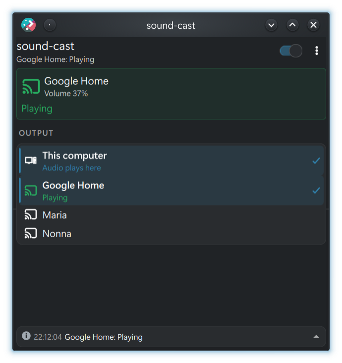
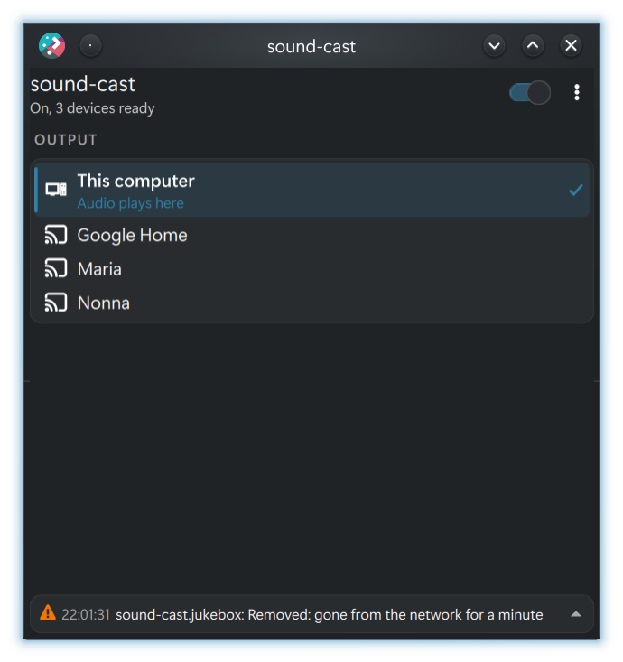

<p align="center"></p>

# sound-cast Plasma widget

A KDE Plasma 6 widget for [sound-cast](https://github.com/iupsilon/sound-cast), which plays
the desktop audio on Chromecast speakers through one PipeWire sink per room.

| Playing on a speaker | Idle |
|---|---|
|  |  |

## The two parts

sound-cast comes in two repositories. Install the daemon first.

| Part | Repository | What it does | Needed |
|---|---|---|---|
| **Daemon** | [iupsilon/sound-cast](https://github.com/iupsilon/sound-cast) | Finds the Chromecasts, creates one PipeWire sink per room and streams the audio to them. | Yes |
| **Plasma widget** | [iupsilon/plasma-applet-sound-cast](https://github.com/iupsilon/plasma-applet-sound-cast) (this one) | KDE Plasma 6 panel and system tray widget: status of every room, one-click output switching, per-room volume, per-app routing, notifications, service on/off, event log. | No |

## Features

- Turns the `sound-cast` user service on and off, and sets it to start at login.
- Shows every room that plays: each step of the connection with its timer, the
  Chromecast volume, buffering, and whether the Chromecast fetches the audio.
- A volume slider and mute button for every room that plays, the track it plays
  and its delay.
- Lists the outputs (this computer and every Chromecast) with their state; one click
  moves the audio there.
- Lists the apps that play: each one can go to its own room, while the rest stay
  where they are.
- Notifies when another app takes a Chromecast (with a button to take it back), when a
  room fails, and when a Chromecast cannot fetch the audio.
- A room the audio left keeps playing silence for 20 s: the list shows its countdown,
  a click brings the audio back before it stops, the stop button ends it at once.
- Takes a Chromecast back when another app (for example YouTube) took it.
- Keeps a log of recent events for troubleshooting: one line with the latest, a click
  opens the list.
- English and Italian.

The widget reads sound-cast's state from its D-Bus object (`org.soundcast.Daemon` on the
session bus, interface `org.soundcast.Daemon1`), the service state from systemd and the
default output from the Plasma audio module, all through change signals: nothing is
polled. Shell commands (`systemctl --user`, `sound-cast-move`) run only when you start or
stop the service or move the audio. The apps' streams come from the Plasma audio
module.

## Requirements

- [sound-cast](https://github.com/iupsilon/sound-cast) 0.1.0 or later, with its
  `sound-cast.service` user unit; the volume slider and mute button, the track,
  the delay and "Look for Chromecasts again" need 0.2.0 or later,
  and stay hidden or greyed out with an older one
- Plasma 6 with `plasma-pa` and `plasma5support`
- `pactl` (libpulse) with a PulseAudio server (`pipewire-pulse`), `python3`
- systemd user services

## Install

Install [sound-cast](https://github.com/iupsilon/sound-cast#install) first, then download
the package for your distribution from the
[latest release](https://github.com/iupsilon/plasma-applet-sound-cast/releases/latest):

| Distribution | Package | Install |
|---|---|---|
| Arch Linux, CachyOS, Manjaro | `plasma6-applets-sound-cast-X.Y.Z-1-any.pkg.tar.zst` | `sudo pacman -U ./plasma6-applets-sound-cast-*.pkg.tar.zst` |
| Debian 13+, Ubuntu 25.04+ (Plasma 6) | `plasma6-applets-sound-cast_X.Y.Z-1_all.deb` | `sudo apt install ./plasma6-applets-sound-cast_*.deb` |
| Fedora (Plasma 6) | `plasma6-applets-sound-cast-X.Y.Z-1.noarch.rpm` | `sudo dnf install ./plasma6-applets-sound-cast-*.rpm` |

The widget is plain QML and a shell script, so the same files work on every
distribution with Plasma 6. It is tested on Arch Linux and CachyOS.

On Arch you can also build the package with the `PKGBUILD` in
[`packaging/arch`](packaging/arch):

```sh
cd packaging/arch && makepkg -si
```

From the [KDE Store](https://store.kde.org/p/2381580/): right-click the panel, **Add or
Manage Widgets**, **Get New Widgets**, **Download New Plasma Widgets**, and search for
"sound-cast". This installs the widget for your user only, in English; the packages above
also bring the translations.

From source, on any distribution:

```sh
sudo make install            # PREFIX=/usr by default
sudo make uninstall
```

Then right-click the panel, **Add or Manage Widgets**, and add "sound-cast" to a panel,
or enable it in the system tray settings. After an upgrade, log out and back in (or
restart `plasmashell`) to load the new version.

## Settings

Right-click the widget, Configure:

- **Service**: the systemd user unit (`sound-cast`).
- **Notifications**: show a notification when another app takes a Chromecast or a
  room fails (on by default). Each copy of the widget notifies on its own: with one in
  the panel and one in the system tray, turn it off in one of them.

The Chromecasts fetch the audio from the sound-cast port (8574 by default), so it must be
reachable from the network (for example `sudo ufw allow 8574/tcp`). The widget warns when
a Chromecast does not fetch it.

## `sound-cast-move`

Command-line helper the widget uses to move the audio:

```sh
sound-cast-move sound-cast.sala     # default output + move the streams there
sound-cast-move --local             # move the streams of the default room back to a local sink
sound-cast-move --local-sink        # print the local sink that --local would use
sound-cast-move --stream 42 sound-cast.sala   # move only stream 42 there
sound-cast-move --stream 42 --local           # move only stream 42 back here
```

Stream numbers are the sink-input indexes of `pactl list short sink-inputs`. A stream
sent to a room of its own stays there when the default output moves; `--local` while the
default output is already local brings back every stream on a Chromecast.

## Development

Install for the current user only and run it in a window:

```sh
make test-install
plasmawindowed org.soundcast.status
make test-uninstall          # the user copy overrides the system one: remove it after
```

`make` targets:

| Target | Does |
|---|---|
| `install`, `uninstall` | install or remove the widget, icon, translations and `sound-cast-move` (`DESTDIR`, `PREFIX`) |
| `test-install`, `test-uninstall` | install for the current user with `kpackagetool6` |
| `pot` | extract the strings to `po/plasma_applet_org.soundcast.status.pot` |
| `merge` | update `po/*.po` from the template and check them |

### Translations

Strings are in `po/`. After changing the UI, run `make merge`, then translate the new
entries in `po/<lang>.po`. Add a language by copying the `.pot` file to `po/<lang>.po`.

## Build the packages

[`packaging/package.sh`](packaging/package.sh) installs the widget into `dist/root` and
builds the `.deb`, `.rpm` and Arch packages into `dist/`. It needs `make`, `gettext` and
[nfpm](https://nfpm.goreleaser.com):

```sh
packaging/package.sh
```

The [Packages workflow](.github/workflows/release.yml) runs it for every push. For a tag
it also publishes a GitHub release with the packages.

## Releasing

1. Set the new version in `package/metadata.json` (`KPlugin.Version`) and in
   `packaging/arch/PKGBUILD` (`pkgver`).
2. Add a section for it at the top of [`CHANGELOG.md`](CHANGELOG.md).
3. Commit, tag and push:

   ```sh
   git tag -a v0.2.0 -m "sound-cast widget 0.2.0"
   git push origin main v0.2.0
   ```

The workflow checks that the tag matches `metadata.json`, builds the packages and
publishes the release with the notes from the changelog.

## License

GPL-3.0-or-later. See [`LICENSE`](LICENSE).
